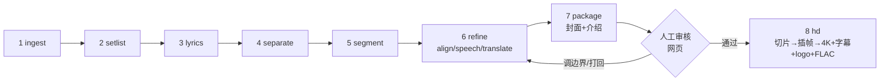

# v2 演唱会整场流程方案

2026-10-17 · 已实现第一版（`workflow_v2/`、`server_v2/`、`web_v2/`），本文同步了实现时的调整

v2 把一整场演唱会拆成单曲，每首出精校双语字幕、候选封面和介绍，在网页上人工审核；审核通过前不做任何高清处理。v1（单首歌曲视频 → 4K60 成品）保持不动，v2 的代码、数据目录和命令都独立。

## 1. 背景与目标

| 项 | v1 | v2 |
| --- | --- | --- |
| 输入 | 单首歌曲链接（YouTube 等） | 整场演唱会本地文件 |
| 拆分 | 无 | 先定位每首歌的起止时间 |
| 帧处理 | 流程中途抽帧插帧 | 只在人工确认后做，按单曲逐首做 |
| 审核 | 无界面 | 本地网页：封面 + 介绍 + 视频加外挂字幕预览 |
| 成品 | 4K60 + 水印 + FLAC + 封面 + 元数据 | 同 v1，但每首一份 |

**首个目标文件**：`~/Downloads/Shakira Live from Madrid 2026 1080p AMZM REPLAY LIVE WEB-DL AAC2.0 H.264-abdci.mkv/` 是一个目录，里面的同名 mkv 才是视频。

- 时长 2:04:52（7492 s），7.4 GB，H.264 1920×1080 30 fps
- 音频 AAC 32 kHz 双声道，低于成品 FLAC 48 kHz/24 bit 的规格。成品只能重采样，音质上限由源决定
- 自带一条英文 SRT 字幕轨（stream 2）：直播实时字幕，大写，**歌词基本都在**，是拆分的主要线索（见第 3 节）
- 2026-10-03 马德里 Estadio Shakira，Las Mujeres Ya No Lloran 巡演，Amazon Music / Prime Video 全球直播（[Euronews](https://euronews.com/2026/10/01/shakira-and-amazon-music-stream-madrid-concert-live-and-free)）

## 2. 整体执行顺序

先定位单曲，再逐首精校歌词，然后人工审核。审核前只处理音频和文本，不切视频、不抽帧。前 7 步跑完共占约 15 GB；第 8 步逐首做，每首做完就删帧。



| # | 阶段 | 做什么 | 主要产出 | 动视频吗 |
| --- | --- | --- | --- | --- |
| 1 | ingest | 探测源文件，抽内嵌字幕轨，整场音频转 FLAC，整文件无损 remux 成 mp4 供网页预览 | `concert.json` `captions.srt` `audio.flac` `source.mp4` | 只 remux（`-c copy`），不切不转码 |
| 2 | setlist | 从 setlist.fm 取歌单，标出歌曲 / tape 过场 / 串烧 / 嘉宾 | `setlist.json` | 否 |
| 3 | lyrics | 按歌单逐首从 Genius 取歌词 | `songs/<nn>/lyrics.txt` | 否 |
| 4 | separate | 整场人声分离（RoFormer，只跑一次） | `vocals.wav` | 否 |
| 5 | segment | 字幕轨 + 歌词文本粗定位，音频特征精修边界 | `segments.json` | 否 |
| 6 | refine | 每首切音频片段，复用 v1 的 align / speech / translate | `songs/<nn>/lyrics.ass` | 否 |
| 7 | package | 每首取候选封面帧，生成标题和介绍 | `songs/<nn>/covers/` `songs/<nn>/meta.json` | 只用 `ffmpeg -ss` 读单帧 |
| — | **人工审核** | 网页上看封面、介绍、视频 + 外挂字幕，调边界，逐首通过 / 打回 | `review.json` | 否 |
| 8 | hd | 只处理已通过的歌：切片 → RIFE 插帧 60 fps → 4K + 字幕 + logo 水印 + FLAC | `hd/<nn>/… 4K60FPS.mp4` | 是，仅此一步 |

命令入口拟为 `python -m workflow_v2 run <concert> --from segment --to package`，`--from/--to` 和 v1 用法一致。`hd` 是单独的子命令，不属于 `run` 的阶段，避免一条命令误跑到高清。

## 3. 整场拆分单曲

思路：**网上取歌单定顺序，歌词文本定大致位置，音频定精确边界，人工兜底。**直接靠音频切分（掌声、静音）不可靠：演唱会里歌与歌常无缝衔接，过场视频也有音乐。有了「第几首是什么歌、歌词是什么」，问题就变成一个带顺序约束的匹配。

### 3.1 歌单（setlist）

- 来源：[setlist.fm](https://www.setlist.fm/setlist/shakira/2026/estadio-shakira-madrid-spain-13497121.html)。歌单以 `concerts/<slug>/setlist.txt` 为准（可手改）：配置了 `SETLISTFM_API_KEY` 时由 API（`/rest/1.0/setlist/{id}`）生成；setlist.fm 网页对脚本有反爬（返回 202 空页），所以没有 key 时手写
- 10/3 这场共 37 项，其中 tape 过场（视频 interlude）11 项、串烧 2 项、嘉宾 2 项（Dua Lipa《Antología》、Ghetto Kids《Dai Dai》）。实际唱的歌约 26 首
- 解析规则：
  - 标 `tape` 的是过场，`kind=interlude`，默认不出成品
  - 「A / B (medley)」合成一段，带两份歌词，复用 v1 的 `lyrics_sections.txt` 多段格式
  - 翻唱或合作曲记下原唱，供查歌词：GIRL LIKE ME → Black Eyed Peas、TQG → KAROL G、La bicicleta → Carlos Vives、BZRP #53 → Bizarrap
  - 「shortened」「alternate lyrics」等备注保留进 `setlist.json`，审核页上显示，提示这首对齐可能不全

### 3.2 粗定位：字幕轨 + 歌词匹配

内嵌字幕轨约 9100 条有文字的行。抽样能和歌单逐一对上：

| 字幕时间 | 字幕原文 | 对应歌曲 |
| --- | --- | --- |
| 00:06:31 | ES QUE TAMBIÉN TENGO MI ORGULLO | La fuerte |
| 00:17:38 | Y NO ENTIENDO DE FÚTBOL | Inevitable |
| 00:25:00 | FELICITO, QUÉ BIEN ACTÚAS | Te felicito |
| 00:57:21 | PURO CHANTAJE | Chantaje |
| 01:24:41 | Y FUE POR TI QUE APRENDÍ A QUERER | Antología |
| 01:43:12 | ZAMINA MINA, ZANGALEWA | Waka Waka |
| 01:58:38 | DE 22 CAMBIASTE | BZRP #53 |

算法（实现：`workflow_v2/segment.py`）：

1. 滚动字幕每条事件只取比上一条新出现的词，还原成连续词流（7370 个词），去重音、去标点
2. 每 3 个词取一个 10 词窗口，和每首歌的歌词逐行 `partial_ratio`，得到「窗口 × 歌曲」得分矩阵
3. 只有「明显只像这一首」（≥ 85 分、且比其他歌高 6 分）的窗口才算证据；oh oh、baby 这类到处都能匹配的不算
4. 单调 DP：按歌单顺序，每首歌占一段连续窗口，允许中间有讲话 / 过场；证据按 90 s 间隔分簇，取最大簇
5. 实时字幕比声音晚约 2.5 s；字幕稀疏时一个窗口会跨很长空白，窗口终点限制在起点后 6 s 内

结果：25 首全部按顺序定位，粗区间和歌单完全一致。

**没有字幕轨的演唱会**（通用后备）：用分离后的人声，按 30 s 窗口、5 s 重叠跑 qwen3-asr-flash（2 小时约 300 次调用），得到的文本走同样的匹配和 DP。有字幕轨时也可以只在低置信度区间补跑 ASR 做交叉验证。

### 3.3 精修边界：转播画面上的歌名字幕（主），音频（后备）

实测音频特征区分不了「前奏」和「过场 / 人群声」：混音的频谱平坦度全场都在 0.6 左右，节奏清晰度在 tape 过场里也很高（过场是带音乐的预录视频）。改用画面：

- **歌名字幕**：Amazon 转播在每首歌期间左下角显示歌名（LA FUERTE、HIPS DON'T LIE…），歌与歌之间显示「LIVE FROM MADRID」。位置写在 `concert.json` 的 `title_box`（这场是 `[40, 976, 660, 56]`）
- 实现：只解码关键帧（约 1 s 一个，整场 9072 帧），裁出该区域、阈值成黑字白底，tesseract 识别，缓存 `title_ocr.json`；整场约 2.5 分钟
- 歌名首帧到末帧 = 这首歌；「MADRID」或别的歌名连续 3 帧以上 = 分隔帧，边界不越过分隔帧
- 歌名区域有时被二维码推广条盖住、读不出：歌名首帧离前一个分隔帧 ≤ 75 s 时，从分隔帧结束算起；结尾同理（≤ 20 s）
- 转播只写歌名前半截也能认（PIES DESCALZOS = Pies descalzos, sueños blancos），但短文字不做部分匹配（MADRID ≠ Te dejo Madrid）
- **没有歌名字幕的片源**：退回音频规则——从第一句往前、从最后一句往后找连续奏乐段，最多 50 s / 40 s，标「边界按音频估计」
- 歌间讲话：人声活跃、不在奏乐、≤ 60 s 的并入下一首开头（需要 `vocals.wav`）

结果：25 首全部由歌名字幕定位。逐首抽开头前后、结尾前后的画面核对，结尾后基本都已是 MADRID 分隔画面。已知偏差：Te felicito 的加长前奏被切掉几秒；GIRL LIKE ME 开头带了约 45 s 讲话。

输出 `segments.json`，每段含 `idx, title, artist, kind, start, end, confidence, notes`。字幕匹配行少（短版、串烧、纯器乐开头）或和相邻段重叠的标为低置信度，审核页上优先提示。

## 4. 单曲歌词精校

每首歌建一个目录，布局与 v1 的 `Song`（`workflow/paths.py`）一致，这样 v1 的 align / speech / translate 不用改就能直接跑。

- 只切**音频**：按 `segments.json` 的区间（不留余量，和将来切视频的区间完全一致）从整场 `audio.flac` 和 `vocals.wav` 切出 `songs/<nn>/audio.flac`、`songs/<nn>/vocals.wav`。不生成 `video_1080.mp4`
- 歌词：`get_ytb_lyrics_from_link.py` 里的 `search_song` / `extract_lyrics` 直接用歌单给的「歌名 + 原唱」查，不再从 YouTube 标题反推
- **对齐（`workflow_v2/concert_align.py` + v1 零件）**：Qwen 2.5 s 窗口识别（v1 `qwen_dense` 的缓存）→ 演唱会排序 DP → 拆重复句 → MMS 逐句精修 ±1.0 s（v1 `tighten`）→ 空档补词 → v1 `verify_qwen` 逐句复核（低于 45 分隐藏）→ 隐藏句带前后文复听 → 现场改词 → 口号句往前延伸 → 列举句一项一句 → 每句统一提前 0.2 s（不再跑 v1 `refine_timing` / `acoustic`：前者在上一句缺失时把下一句拉早好几秒，后者只认参考歌词、会改掉补进来的现场词）
  - 混合语种的歌（`song.json` 的 `langs` 多于一种）Qwen 不指定语言（auto）；强制英语会在人群声里编出「Thank you」、整句副歌
  - **空档补词**（`gap_fill.fill`）：字幕之间明显在唱、却没有字幕的空档（≥3 s，人声占比 ≥0.4），前后各多带 0.8 s 送 Qwen 整段识别，MMS 逐词对齐后按标点切成短句补进去；识别结果和某句 Genius 歌词很像（≥72）时用 Genius 的写法
  - **现场改词**（`gap_fill.adopt_heard`）：①可疑句里一个实词都和复核听到的对不上、听到的也不是别的 Genius 句子（Latinas, latinas → Las argentinas）；②补进来的句子复核时多听出几个词（漏了 ecuatoriana）。前后各多 0.8 s 再识别一遍，新词两遍都按整词听到才换；只对上一部分时按原起止听第三遍，用那一遍的文字
  - **隐藏句复听**（`gap_fill.rescue_hidden`）：逐句复核只听这句自己的起止，拖长音的短句常听错（「you're lookin' for」1.8 s 认成「People」）被隐藏，留下几秒空白；前后各多 0.8 s 再听，实词六成以上听到、那段时间也空着就放回来
  - **列举句一项一句**（`gap_fill.split_lists`）：报国家名这类逗号 / y 分开、每项不超过 3 个词、每项平均 ≥1.2 s 的句子（口号句除外），MMS 和紧挨着的下一句一起逐词对齐，每项从开口到下一项开口；下一句开口比原边界晚就把它往后挪（GIRL LIKE ME：一拍一个国家名，约 1.9 s 一项，Las argentinas 原来早了 1.9 s）
  - **统一提前 0.2 s**（`gap_fill.lead_all`，精校最后一步）：对齐的、补进来的、放回的、拆开的句子都一样提前出现；不早于上一句结尾，和下一句首尾相接的结尾跟着提前
  - **Qwen 识别缓存**（`reports/qwen_cache.json`，v1 `qwen_asr.transcribe` 在设置了 `QWEN_CACHE` 时启用）：同一段音频 + 同一语言只识别一次。不加缓存时每次重跑 Qwen 的听法都不一样（Las argentinas / Es Argentina / Americana, Argentina 轮流出现），审核过的字幕重跑会变；边界改了音频不同，自然重新识别。想重新听就删掉这个文件
  - 现场改词的「换词」要听三遍（复核那遍、前后各多 0.8 s、按原起止），每遍先去掉开头「上一句最后一个词的尾音」（边界没修好时这句开头带着 Dominicana 的尾音，Qwen 听成 Americana），选被别的遍证实的那遍
  - 空档补词认 Genius 写法除了整句字符相似度，也看词重合（两边一半以上的词对得上、至少 3 个实词）：want a girl who shines the candle -> I want a girl that shine like glitter
  - 空档补词的防幻听：识别出非拉丁文字（俄文、中日文）不补；单一语种的歌再按歌的语种强制识别一遍，两遍对不上的短句不补（BZRP 人群声里冒出过俄语、法语句子）
  - **补词换成该唱的歌词**（`gap_fill.fill_expected`）：补词段前后已对齐的两句 Genius 歌词（前一句取歌词里在后一句之前的最近一句，现场顺序和 Genius 不同的跳过），歌词里夹在中间、DP 没对上的句子就是这里该唱的；补词文字 + 复核听到的 + 前后文再听一遍，按词干比（mastique' ≈ masticas）听到某句四成以上（至少 3 个词）就换成这句（BZRP 1:30「Esto es pa' que te mortifique'…」、Dai Dai 副歌第二遍）
  - **补词换成歌词**（`gap_fill.snap_runs`）：连续的补词句（含被隐藏的）前后各多 0.8 s 再听一遍，某句 Genius 歌词 3/4 以上的词听到了，就把这段换成这句（BZRP：「¿Dónde queda nuestra culpa / Me hagan que critique」→「Entendí que no es culpa mía que te critiquen」）
  - 隐藏句复听时，听到的文字要最像这句本身（相邻字幕不算，前后文会带进来）；更像别的歌词句子就不放回
  - Genius 歌词里混着长得一样的西里尔字母（quе 的 е），lyrics 阶段统一换成拉丁字母
  - 每句字幕的来源记在 `reports/asr_lines.json`（`source`：`asr_lyric` / `asr` / `adopt`，`adopt` 带 Genius 原词 `was`），其余都是 Genius 原词按声音对齐。审核页「来源」列：Genius / Qwen→Genius / Qwen 补词 / Qwen 改词；「Qwen 复核听到」列是 `verify_qwen` 把这句时间段的人声单独再识别一遍的文字，只用来核对，不直接当字幕
  - 为什么不能直接用 v1 dense：段落模式进入一段就整段补齐（缩短版 / 串烧冒出没唱的句子）、同一句连唱两遍合成一条长字幕；free 模式每窗独立选句，长句里包含的短句（「So they tell me … a girl like me」⊃「A girl like me」）会抢窗口，字幕来回跳
  - 演唱会排序 DP：段内顺着唱、可以跳一句（罚分）、可以从任何一句退出，没有识别证据的句子不输出；窗口打分乘上「这句解释了窗口文字的比例」，长句优先
  - 拆重复句：一句时长超过应有长度（每词约 0.3 s）的 1.6 倍时，看 Qwen 窗口里这句开头几个词出现了几簇，每簇拆成一遍
  - Genius 歌词里的 U+2005 等特殊空格统一成普通空格（否则同一句被当成两句）
  - 验收（GIRL LIKE ME / Waka Waka / Dai Dai / BZRP #53，对照一次性的 Whisper 逐词时间）：开头偏差中位 0.27 s，≤0.5 s 77%，≤1 s 90%；v1 dense ±0.6 s 精修是 0.75 s / 39%。逐句 Qwen 复听：72%~90% 的句子能听出是这句（观众合唱、说唱段 Qwen 本身认不全）
  - **直播字幕轨不能用来对齐或检查**（试过，失败）：延迟忽长忽短（−2 ~ +8 s），说唱段像提前打好的稿。只在 segment 阶段粗定位哪首歌在哪（±10 s）
- 翻译规则（v1 `translate_ass.py` 提示词）：专有名词用通行中文名（Twingo → 雷诺）；称呼女性不用「妞」，用「女孩」；结巴式重复的名字按中文译名首字重复（Sha-Sha-Shakira → 夏-夏-夏奇拉，La-La-Latinas → 拉拉拉丁女孩）
- 讲话 / 翻译仍用 v1：`make_mv.py --from speech` / `--from translate`（v1 `paths.POSTS` 支持环境变量 `ADELE_POSTS`，v2 把它指向 `concerts/<slug>/songs/`）。讲话识别会在前奏的人群声里编出「¡Aplausos!」「¡Ah!」，翻译前先把纯语气词、拟声、舞台说明过滤掉
- Qwen 识别一次只跑一首：每首内部已有 3 路并发，多首并行会触发 429 限流（v1 `qwen_dense.py` 原先还会把失败的窗口当空结果写进缓存，已修复）
- 边界改了以后重跑 refine 会自动重切音频、清掉旧时间轴的结果；翻译缓存保留，不用重翻
- 字幕时间以**单曲片段起点**为 0，与将来切出的单曲视频一致；网页预览时再加上片段偏移
- 审核页标红：v1 逐句 Qwen 复核的可疑句（`reports/verify_report.json`）
- 预览视频：每首从 source.mp4 精确切出 720p 预览（`songs/<nn>/preview.mp4`，前后各多留 10 s 方便调边界），审核页播放它、字幕时间从片段起点算，不在 2 小时的整场文件里跳转。25 首共 2.6 GB；和高清成品无关

## 5. 封面与介绍

- **候选封面**：`make_cover.py` 的默认流程（YuNet + SFace 找演唱者正脸），每首 12 张：正脸特写 6、半身 3、全身 3（`--per-shot closeup=6,half=3,full=3`；某个景别找不到可靠的正脸时，在同一段里按清晰度补齐到 12 张），16:9 和 4:3 各一份，已做 Real-ESRGAN 高清化（单首约 6 分钟，一次只跑一首），hd 阶段直接拷贝选中的那张。`make_cover.py` 新增 `--start/--end`，只在片段内用 `ffmpeg -ss` 取单帧，不落地帧序列
- 标题 + 副标题整体上移画面高度的 8%（`make_cover.py --text-lift 0.08`；特写 0.82 → 0.74、半身 0.74 → 0.66、全身 0.66 → 0.58）：底部 17% 压暗后字太靠下
- 副标题「夏奇拉 Shakira · 中西字幕」（中文名来自 `concert.json` 的 `artist_zh`）用 `--sub-fit natural`：字号最大到标题的 0.72（至少画布高的 11.5%，但不超过标题的 0.85），宽度最多到标题宽的 88% / 画布宽的 85%，正常字距、居中，不拉宽到和标题等宽。文字样式改了用 `make_cover.py --recompose`（`package.recompose_covers`）在已有高清帧上重排，几秒一首
- 特写的脸高下限从 0.22 降到 0.14（`--closeup-min`）：转播里大特写很少（GIRL LIKE ME 只有 6 帧候选），近景也算特写，才凑得够 6 张
- 转播画面右下角有「amazon music REPLAY」台标、底部会弹二维码推广条：封面用 `--mask-bottom 0.17` 把底部模糊压暗（`concert.json` 的 `cover_mask_bottom`；0.12 盖不住推广条上沿）
- **标题**：固定格式，不让模型写（`package.post_title`）：`[4K60帧/Hi-Res] {歌手中文} 《{歌名原文}》{歌手英文} {歌名中文} {演唱会中文名} {演唱会英文名} 中x字幕`，例：`[4K60帧/Hi-Res] 夏奇拉 《La fuerte》Shakira 马德里演唱会2026 Live from Madrid 2026 中西字幕`。演唱会中文名、英文名都必须有（`concert.json` 的 `title_zh` / `title_en`，没有 `title_en` 才用 `title`；正式英文名太长就在 `title_en` 写简称，如 Lorde 的 `ACL Festival 2026`），都去掉歌手名，英文名代替「Live 现场」；歌名中文取字幕片头那行的翻译（`zh_cache.json` 的 `__title__`，和原文一样就不写）。B 站标题上限 80 字，超长时依次去掉：英文名里的年份 → 中文名里的年份（年份留在英文名里）→ 两边的年份 → 英文名 → 中文名。封面第二行带演唱会简称（`concert.json` 的 `title_short`，没有就用 `title_zh`）：`洛德 Lorde · ACL音乐节2026 · 中英字幕`
- **简介**：复用 `make_meta.py` 的提示词，事实材料换成：场次、巡演名、本场第几首、歌单备注、转播信息，以及 Genius 的发行日期和合作艺人；歌曲介绍、演出介绍各 300~400 字（太短重写一次），合成一段、空行分开（`post_draft.json` 的 `intro_text`）。审核页里是一个文本框，保存为 `review.json` 的 `intro`
- **标签**：审核页按一个个 tag 显示，× 删除、回车或逗号添加

## 6. 前端审核页面

直接从 SubDub 拷过来改。SubDub（`/Users/gold/repos/SubDub`）是纯 HTML + 原生 JS + FastAPI，没有构建步骤。它的 `web/subs.js` 自己解析 ASS、用 DOM 叠加字幕，而且就是按 adele 的 bzrp 样式调的，可以原样复用。

```
┌────────────────┬──────────────────────────────────────────────┐
│ Shakira Madrid │  08 Te felicito   23:00–24:54  待审 · 可审核     │
│ 2026-10-03     │ ┌──────────────────────┐ ┌─────┐┌─────┐       │
│                │ │ 单曲预览 preview.mp4  │ │16:9 ││16:9 │ 16:9/4:3│
│ ● 03 La fuerte │ │   + 外挂 ASS 字幕     │ └─────┘└─────┘       │
│ ● 04 GIRL LIKE │ └──────────────────────┘ ┌─────┐┌─────┐       │
│ ○ 05 Las de la │ [从头][听结尾] 双语/中/原/关 │16:9 ││16:9 │       │
│ ~ Robot Interl │ 开头 ±0.5 设为当前 · 结尾 …  └─────┘└─────┘       │
│ ⚠ 10 Don't Bo. │ 整场时间轴 ▕▔█▔▔█▔▔█▔▔▔█▔▏                      │
│   …            ├──────────────────────────────────────────────┤
│                │ 投稿标题 [     ]        标签 [        ]        │
│                │ 歌曲介绍 [     ]        演出介绍 [     ]        │
│                │ 备注 [               ]  [保存] [通过] [打回]   │
│                ├──────────────────────────────────────────────┤
│                │ 时间 │ 原文 │ 中文 │ Qwen 复核（红=可疑）           │
└────────────────┴──────────────────────────────────────────────┘
```

**保留自 SubDub**：侧边栏列表、hash 路由（`#/<concert>/<nn>@<sec>`）、`.stage` + `SubOverlay` 外挂字幕、字幕模式切换、全屏、逐句表格点击跳转、`/media` 白名单文件服务。

**删掉**：音色对比页、配音多轨 `Player`（改用 `<video>` 自带音轨）、TTS 统计列、prompt 面板、fork 分组。

**新增**：

- 左侧：歌单，每首显示审核状态（待审 / 通过 / 打回 / 通过后有改动）、时长、⚠（定位置信度低或边界改过待重跑）；过场灰字显示
- 左上：单曲预览视频 + 外挂 ASS 字幕（`SubOverlay` 加了 offset 参数），到结尾自动暂停；「设为开头 / 结尾」「±0.5 s」微调边界；整场时间轴条
- 右上：候选封面（16:9 / 4:3 切换，单选）
- 下方：标题、歌曲介绍、演出介绍、标签、备注可编辑，保存 / 通过 / 打回；最下是逐句字幕表，时间存疑的行标红

**接口**（端口 8160，避开 SubDub 的 8150）：

| 方法 | 路径 | 作用 |
| --- | --- | --- |
| GET | `/api/concerts` | 场次列表 |
| GET | `/api/concerts/{c}` | 歌单、段落、每首状态 |
| GET | `/api/concerts/{c}/songs/{nn}` | 段落、字幕行、候选封面、meta、审核状态 |
| POST | `/api/concerts/{c}/songs/{nn}/review` | 保存选中封面、标题、介绍、边界、状态、备注 |
| POST | `/api/concerts/{c}/songs/{nn}/rerun` | 边界改了以后从 refine 重跑这一首（后台任务，一次一首） |
| POST | `/api/concerts/{c}/songs/{nn}/segment` | 保存人工调整的边界（不能和相邻的歌重叠） |
| GET | `/media/{c}/{path}` | `source.mp4`、`songs/*/lyrics.ass`、`songs/*/covers/*.jpg` |

SubDub 是只读的；v2 新增的两个 POST 只写 `review.json` 和触发重跑，不碰源文件。

## 7. 人工确认后的高清流程

`python -m workflow_v2 hd <concert>` 是唯一会切视频、抽帧的命令（`--dry-run` 只列出会处理哪些歌）。成品放在 `songs/<nn>/post/`，和 v1 的 `posts/<name>/post/` 布局一致。

**闸门**：

- 只处理 `review.json` 里 `status=approved` 的歌
- 通过时记录指纹（边界 + `lyrics.ass` + 选中封面的哈希）；之后这些有任何改动，通过就失效，需要重新审核
- 没有一首通过时直接退出，不做任何事

**每首按顺序处理，一首做完再做下一首**：

1. 切片：调用 v1 `make_mv.py --from interp --to render --start --end --clean-frames`，从 `source.mp4` 切出 `video_1080.mp4`（v1 的 `make_1080`，crf 12），渲染完删掉
2. 插帧：RIFE 30 → 60 fps（沿用 v1 interp）
3. 渲染：lanczos 放大到 3840×2160，烧录 `lyrics.ass`，叠加 `assets/adele-logo.png` 水印，音轨用片段 FLAC 48 kHz/24 bit（`check_hires` 校验）
4. 选中的封面跑 Real-ESRGAN，出最终 16:9 / 4:3；写投稿元数据 JSON
5. **立即删除** `frames_in/` 和 `frames_out/`（v1 默认保留，v2 默认删除）
6. 每首开始前用 v1 的 `pick_frame_ext` 检查磁盘，不够就停下并报告；已有成品的歌跳过，支持断点续跑

## 8. 目录结构与存储

v2 不改 v1 文件。代码放 `workflow_v2/`，数据放 `concerts/`（已加入 .gitignore），审核页放 `web_v2/` + `server_v2/`。v1 的能力通过 import 或子进程复用；对 v1 只做了两处改动，默认行为都不变：`paths.POSTS` 可由环境变量 `ADELE_POSTS` 覆盖，`make_cover.py` 新增 `--start/--end`。

```
concerts/shakira_madrid_2026/
  concert.json        源路径、时长、fps、艺人、日期、场馆、title_box、cover_mask_bottom
  source.mp4          remux 预览用
  captions.srt        内嵌字幕轨
  audio.flac          整场 48k/24bit
  vocals.wav          整场人声
  setlist.txt / setlist.json
  title_ocr.json      关键帧歌名 OCR 缓存
  features.npz        音频特征缓存
  segments.json
  review.json
  songs/08_te_felicito/   v1 Song 布局：song.json audio.flac vocals.wav lyrics.txt lyrics_sections.txt
                          lyrics.srt speech.srt lyrics.ass zh_cache.json post_draft.json covers/ reports/
                          post/   审核通过后才出现：成品 mp4、最终封面、投稿 JSON
```

存储估算（当前磁盘剩余 77 GB）：

| 内容 | 大小 | 说明 |
| --- | --- | --- |
| `source.mp4` | 7.4 GB | 无损 remux；若浏览器能直接播 mkv 可改成软链接，省掉这份 |
| `audio.flac` | 约 1.3 GB | 2 h 48 kHz/24 bit 立体声 |
| `vocals.wav` | 约 2.9 GB | float32 立体声 |
| `songs/` 音频片段 | 约 4 GB | 合计约等于整场 |
| 封面候选、字幕、JSON | < 0.5 GB | |
| **审核前合计** | **约 15 GB** | |
| hd 单首帧序列（峰值） | 约 7 GB（JPG）/ 约 40 GB（PNG） | 4 min：7200 帧 in + 14400 帧 out，做完即删 |
| hd 成品 | 约 0.7 GB / 首 | 参考 v1 4 min 成品 666 MB；26 首约 18 GB |

整场一次性抽帧是 22.5 万帧 in + 45 万帧 out，PNG 量级在 1 TB 以上，所以只能逐首做、做完即删。

## 9. 风险、待确认问题与里程碑

**风险**

- 转播画面自带「amazon music REPLAY」台标、周期性二维码推广条和左下角歌名，成品里都会保留（封面已遮盖）。要去掉需要额外的 delogo / 裁切方案，待定
- 实时字幕滞后且漏字，短版歌、串烧、纯器乐开头的边界会偏。靠 3.3 的音频精修 + 审核页微调兜底
- 现场改词、即兴和合唱段对齐会漏。字幕轨交叉检查，标红让人工看
- 源音频只有 32 kHz AAC，成品的 FLAC 48k/24bit 是重采样，Hi-Res 只是格式达标
- tape 过场是预录的视频和音乐，版权风险高、价值低，默认不出成品

**待确认**

- 过场 / 讲话段是否需要单独出片？默认不出
- 歌间讲话并入下一首，还是单独成段？默认 ≤ 60 s 并入下一首
- 演唱会单曲的标题模板，例如「Shakira《Te felicito》马德里 2026 现场 4K60 中西双语」，是否带「本场第几首」？
- 成品是否要出 B 站合集 / 分 P 的元数据？

**里程碑**

1. M1 拆分：ingest + setlist + lyrics + separate + segment，在 Shakira 这场上人工核对 `segments.json`
2. M2 精校：refine + package，每首出 `lyrics.ass`、候选封面、`meta.json`
3. M3 审核页：从 SubDub 拷贝改造，先做只读预览 + 封面 / 介绍编辑 + 通过 / 打回
4. M4 高清：`hd` 子命令 + 审核闸门 + 逐首删帧
5. M5 审核页里调边界后直接重跑单首
