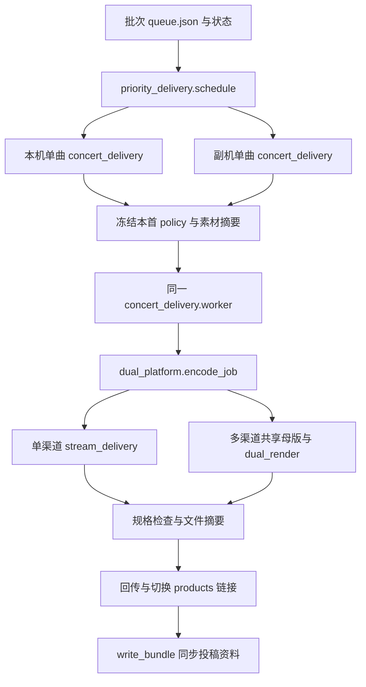
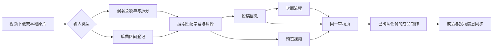

# 标准工作流调用链与重构方案

2026-11-16 · 方案稿，尚未实施

最终保留一套完整工作流，覆盖视频下载、演唱会拆分、字幕搜索匹配、投稿信息与审稿、预览、封面和成品制作。本地与双 Mac 使用同一套阶段实现、任务状态和交付规则，区别仅在执行机器。所有改进进入正式模块，批次目录只保存任务参数、日志、结果和历史证据。

原来的标准入口仍然存在：`workflow.live run` 负责准备审核资料，`workflow.live hd` 单独启动成品。当前复杂度主要来自旧成品链、新双 Mac 制作链、批次编排脚本同时存在，以及部分新能力尚未接回原标准入口。重构应收拢这些调用关系，同时保留苹果流式编码、双机派工、缓存、断点续跑、制作计时和投稿信息同步。

本次只梳理并新增本文。业务代码不作改动。依照用户最新指令，当前两台机器各自收尾正在执行的歌曲，批次通过已有 `PAUSED` 标记停止后续派工；这项运行控制独立于重构。

## 1. 原标准入口及实际调用链

### 1.1 演唱会准备与审稿

入口：[workflow/live/__main__.py](/Users/gold/repos/adele/workflow/live/__main__.py:33)。`cmd_run` 根据 `--from / --to` 截取固定阶段，再动态导入对应 `stage_<阶段>` 函数。

```text
python -m workflow.live run <slug>
  └─ cmd_run → stage_fn
     ├─ ingest   探测原片、字幕轨、音频及浏览器可用的视频
     ├─ setlist  获取或读取演唱会歌单
     ├─ lyrics   搜索并获取参考歌词
     ├─ separate 人声分离
     ├─ segment  按歌单、字幕和音频定位歌曲边界
     ├─ refine   切单曲音频、准备预览、调用逐首字幕流程
     ├─ preview  生成或复用预览
     └─ package  投稿草稿、传统候选封面、水印与展示资料
         ↓
     server / web 审稿页
```

`refine` 的主调用为 `refine_one → cut_audio / make_preview → workflow.song.run song <slug> <name>`。字幕流程完成后进入 `song_translation_workflow.translate`，演唱会分支还调用 `watermark.ensure_song`。参考：[refine.py](/Users/gold/repos/adele/workflow/live/refine.py:93)、[song/run.py](/Users/gold/repos/adele/workflow/song/run.py:709)。

`preview` 在固定阶段中独立存在，而 `refine` 内也调用预览。已有复用判断可避免部分重复编码，但“谁负责触发预览”的职责仍有重叠。`package` 当前实际生成传统候选封面，并未直接串起后来的 FIBO 封面发布链。参考：[preview.py](/Users/gold/repos/adele/workflow/live/preview.py:18)、[package.py](/Users/gold/repos/adele/workflow/live/package.py:306)。

### 1.2 原成品链

```text
python -m workflow.live hd <slug>
  └─ cmd_hd → live.hd.run_hd
     ├─ approved：读取审核状态与变更状态
     └─ hd_one
        ├─ workflow.song.render song:<slug>:<name>
        │  ├─ ensure_subs / ensure_watermark
        │  ├─ make_mv.py --from interp --to interp
        │  └─ 字幕、水印、4K 编码及帧缓存清理
        ├─ 复制传统选中封面
        └─ live.hd.write_post：写旧格式投稿文件
```

这说明原来的 `run` 并不包含成品制作或自动投稿，`hd` 才是成品入口。`song.render` 仍保留 RIFE 帧序列及相邻歌曲插帧、编码交错的逻辑；当前新链还从它导入编码预设，不能直接删除整个文件。参考：[live/hd.py](/Users/gold/repos/adele/workflow/live/hd.py:55)、[song/render.py](/Users/gold/repos/adele/workflow/song/render.py:188)。

### 1.3 单曲输入链

单曲原入口为 `workflow/make_mv.py`，阶段是 `download → prep → lyrics → separate → interp`，同样支持 `--from / --to`。准备审核资料通常先执行到 `separate`，再调用 `workflow.song.run post <name>` 等后续模块。

下载阶段已经调用 `youtube_download.cli_args`，统一 PO Token、代理与 Cookie 参数；下载后的音视频轨、时长检查和外盘存储也已有实现。这些应作为正式输入模块保留。参考：[make_mv.py](/Users/gold/repos/adele/workflow/make_mv.py:78)、[youtube_download.py](/Users/gold/repos/adele/workflow/youtube_download.py:89)。

演唱会与单曲可以有不同输入适配器，但进入逐首处理后，应共享字幕、投稿资料、预览、封面和成品阶段。不能再为每支 MV 或每场演出复制一份总流程。

## 2. 当前新增的正式能力及调用链

### 2.1 双 Mac 成品制作



实际分工如下。

| 层 | 现有实现 | 当前职责 |
| --- | --- | --- |
| 跨场任务分配 | `priority_delivery.schedule` | 从已确认队列按首派工，每台一首；接管存活子任务；处理暂停、待审名单、失败冷却与合集清单 |
| 单首准备和交付 | `concert_delivery.run` | 读取选定原片与切片、准备叠加素材、生成输入摘要、复用合格结果、启动执行器、回传后安装成品 |
| 本机／SSH 执行 | `concert_delivery.worker / Remote` | 相同渲染函数；副机缓存原片、同步代码和作业、回传成品及日志 |
| 编码引擎 | `dual_platform.encode_job` | 按所选渠道进入流式或共享母版路径，检查输出规格 |
| 单渠道快速路径 | `stream_delivery.encode` | 解码、苹果插帧、字幕水印合成、HEVC 编码通过有界管道连接，不落地中间视频或帧图片 |
| 多渠道路径 | `original_master / dual_render` | 共享 60fps 母版后生成所选平台成品；与单渠道流式路径是不同输出策略 |
| 资料同步 | `delivery_bundle.write_bundle` | 更新成品绝对路径、制作机器、耗时、两平台投稿导出与统一交付包 |

依据：[priority_delivery.py](/Users/gold/repos/adele/workflow/priority_delivery.py:74)、[concert_delivery.py](/Users/gold/repos/adele/workflow/concert_delivery.py:184)、[dual_platform.py](/Users/gold/repos/adele/workflow/dual_platform.py:75)、[stream_delivery.py](/Users/gold/repos/adele/workflow/stream_delivery.py:114)。

`concert_delivery` 已支持一场内部双机分配；外层 `priority_delivery` 又按首分配机器，并用 `--single-worker` 调用它。目前通过该参数分工，但存在两层机器分配策略。目标应只留一个调度者，单曲制作函数不再决定“这首交给哪台机器”。

当前默认配置为 B站单渠道、流式编码、关闭制作前额外内容审查。`content_check.check_for_render` 默认生成 `prepared_preview / not_requested` 输入快照，用于确认边界、字幕等未在制作中变化，不代表重新做了一遍听审。严格 ASR／音乐边界检查是另一条可选路径。参考：[delivery_defaults.json](/Users/gold/repos/adele/delivery_defaults.json)、[content_check.py](/Users/gold/repos/adele/workflow/content_check.py:24)。

### 2.2 封面与投稿同步

正式 AI 封面链已经存在，应并入统一工作流的封面模块：

```text
本曲原帧与封面计划
  → fibo_reference：选择／重选参考帧
  → fibo_concert.generate_one → fibo_cover：生成 AI 母图
  → reviewed_cover.stage：生成待复核版本及摘要
  → 视觉复核绑定该版本
  → reviewed_cover.publish / verify_release
  → delivery_bundle.sync_cover_release → write_bundle
```

`fibo_dual_queue` 当前提供双机按首消费与复用、发布等编排。它的业务步骤要保留，独立机器分配逻辑应逐步接入统一执行层。封面复核仅针对新生成的封面版本，不应在每次成品制作时重新生成、重新审核已有封面。

投稿信息已有统一生成与导出基础：`live.package.draft_meta → make_meta.generate_intro` 生成正文，`bili_title` 生成自动标题，人工修改有明确优先级。页面与完整 JSON 使用 `delivery_bundle.submission_records`，`write_bundle` 导出两平台记录。目标是所有调用方都使用这套接口，退出另写一份投稿信息的旁路。参考：[投稿信息流程](/Users/gold/repos/adele/docs/design/posting_content_flow.md)、[delivery_bundle.py](/Users/gold/repos/adele/workflow/delivery_bundle.py:55)。

## 3. 最终一套工作流的七个模块

统一入口应在现有 `workflow.live` 编排基础上演进，覆盖单曲输入适配；不再新建一套与它并列的“统一工作流 V3”。阶段可以单独续跑，也能由同一个入口按依赖串起全过程。具体 CLI 扩展属于后续实现，下面的模块名是职责划分，并非现成新增命令。

| 模块 | 输入与输出 | 保留并收拢的现有实现 | 职责边界 |
| --- | --- | --- | --- |
| 1. 视频获取 | 链接／本地文件 → 已登记原片、来源与轨道信息 | `youtube_download`、`make_mv.stage_download`、`live.ingest`、存储模块 | 统一下载会话与原片登记，源文件存外盘；不混入字幕或成品编码 |
| 2. 演唱会拆分 | 整场原片、歌单 → 每首来源与起止点 | `live.setlist / lyrics / separate / segment`、`vertical_source` | 演唱会执行拆分；单曲登记完整或指定区间后进入共同逐首链。用户修正边界写正式数据 |
| 3. 字幕搜索与匹配 | 单曲音频、参考歌词／源字幕 → 现场文本、时间轴、翻译与 ASS | `live.lyrics / refine`、`song.listen / align / run / song_translation_workflow` | 保留现场 ASR、串烧改词及讲话处理；已有定稿制作时直接复用，只有本模块被要求重跑才重识别 |
| 4. 投稿信息与审稿 | 歌曲事实、字幕结果、人工修改 → 标题、简介、标签、审稿状态 | `live.package.draft_meta`、`make_meta`、`bili_title`、`live.review`、`server / web`、`delivery_bundle` | 只有一套正文与人工覆盖规则；页面、完整 JSON、复制和导出共用；不把成品或发布成功当作审稿状态 |
| 5. 预览视频 | 确定边界、字幕、水印 → 轻量可播放预览及时间偏移 | `live.preview`、`preview_batch`、`vertical_preview` 的通用部分 | 统一时间轴和复用规则；字幕模块可以请求预览服务，但不再复制一套预览实现 |
| 6. 封面 | 本曲原帧、投稿文案 → 经复核发布的封面版本及各比例路径 | FIBO、`reviewed_cover`、`posting_cover` | 生成、试排、复核、发布、同步属于本模块；重做保留旧版直到新版本发布，更新两平台资料 |
| 7. 成品制作 | 已确认预览对应的输入快照、所选渠道 → 外盘成品、机器日志、耗时及交付包 | `concert_delivery.worker`、`dual_platform.encode_job`、`stream_delivery`、`dual_render`、`delivery_bundle` | 内置盘插帧与临时处理，外盘交付；B站单渠道默认直接流式编码，双渠道按需要共享母版；不自动重做字幕、封面或投稿 |

审稿页依赖预览和封面，但投稿正文可以提前生成；因此这是一套有依赖的工作流，不必把所有步骤强制做成一条不可分叉的长脚本。



对于已确认队列，直接从第 7 模块接续。用户要求完整制作尚未处理的新项目时，才走前面的准备流程。纳入范围和等待用户审核的状态保存在正式任务数据中，不在不同脚本里分别推断。

## 4. 保留、合并与退出清单

### 4.1 应保留的能力

| 实现 | 处置 | 原因 |
| --- | --- | --- |
| `workflow.live` 各阶段、`Concert`、正式路径及歌曲数据 | 保留并作为统一入口基础 | 已有完整阶段顺序、续跑参数、日志和审稿数据模型 |
| `workflow.song` 识别、对齐、翻译、水印及边界修正通用能力 | 保留 | 已有现场歌词处理与预览定稿，不应重新实现一套 |
| `youtube_download` 与原片获取、校验、归档 | 保留 | PO Token 等属于共用输入能力，不能散落到每批下载脚本 |
| `bili_title`、`draft_meta`、`submission_records / write_bundle` | 保留并设为唯一内容出口 | 解决标题、简介、标签、封面路径和成品路径不一致 |
| FIBO 生成、精确版本复核发布、`posting_cover` | 保留 | 正式封面流程和命名规则已具备，需接回统一阶段 |
| `stream_delivery` 与 Apple 插帧、HEVC 编码 | 保留为单渠道默认实现 | 符合不落地中间视频／帧图片的高效流程 |
| `original_master / dual_render` 多渠道实现 | 保留为输出策略 | 多渠道共享处理有独立用途，不是单渠道必须执行的中间步骤 |
| 任务锁、存活进程接管、SHA 缓存、远端源缓存、回传后安装 | 保留并收拢到执行层 | 避免重复制作、重复传输和半成品交付 |
| 制作机器、阶段计时、作业版本、实际文件检查 | 保留 | 直接支撑页面与进度、速度分析 |
| TS 音频时钟恢复、失败回收全部管道进程、原子 JSON 写入 | 保留为底层修复 | 已解决实际媒体或并发问题，不应随临时脚本清理丢失 |

### 4.2 重复与职责重叠

| 当前重叠 | 具体依据 | 目标归属及退出方式 |
| --- | --- | --- |
| 旧 `live.hd → song.render` 与新 `concert_delivery → encode_job` 两条成品链 | 两边都有准备素材、编码、记录产物及投稿文件的职责 | 成品模块仅保留新引擎；旧 `hd` 先变为调用相同模块的兼容入口，再退出旧实现 |
| `dual_platform._produce` 与 `concert_delivery.run` 都准备单曲作业 | 都读取来源、配置叠加、拷贝水印、写 policy 后编码 | 抽出同一个单曲作业准备函数；本地、SSH、直调只选择执行器 |
| 外层 `priority_delivery` 与内层 `concert_delivery.run` 都分配机器 | 内层按索引分组，外层按机器派单首 | 机器分配仅保留在一个执行层，单曲函数只执行一首 |
| FIBO 双机队列与成品双机队列各自管理机器 | `fibo_dual_queue` 和 `priority_delivery` 分别派工 | 共享机器占用、暂停和失败状态；封面与成品仍保留各自的业务阶段，不另造独立总流程 |
| `refine` 和 `preview` 都触发预览 | `refine_one` 内调用 `make_preview`，固定阶段后面又有 `preview` | 统一预览服务与依赖失效规则，避免重复启动；保留字幕调试需要的轻量预览能力 |
| `live.hd.write_post` 与 `delivery_bundle.write_bundle` | 旧格式拼装 files／title／intro，新出口同时服务页面与两平台 | 唯一内容构建使用 `submission_records`；旧格式只作为过渡导出，不再独立决定正文 |
| 来源与切片分散在 `segments.json`、`song.json.slice`、`vertical_source.json` | `refine`、旧 render、新 delivery 读取规则不同 | 同一个来源／时间轴解析接口，明确优先级；旧字段先作为兼容投影，不立即迁移或删除 |
| `package.make_covers` 传统候选与 FIBO 正式封面链并存 | 标准 package 仍做传统候选；AI 生成通过另一组模块运行 | 同一封面模块选择明确策略，当前正式默认走既定 FIBO 流程，候选帧能力供参考选择使用 |
| 批次脚本组合字幕、元数据、封面和审稿登记 | `work/.../pipeline.py`、MV 专属 `run.py` | 提取通用能力回七个模块，批次只提供项目事实、歌单、选择和参数 |

`dual_platform` 与 `concert_delivery` 之间还存在双向模块依赖：前者 `_produce` 局部导入后者的 `source_digest`，后者顶层导入前者的 `encode_job`。摘要缓存属于公共执行支持，应提取后消除依赖环；不需要因此再新增一套业务编排。

### 4.3 退出默认制作链的额外审查

`content_check` 当前混合了输入快照、内容检查与制作门禁。重构时拆清职责：输入版本冻结与制作期间变更检测留在成品模块；ASR 差异、音乐边界听审与自动字幕／切片修复归字幕、拆分模块的显式诊断操作。

`content_repair`、`source_lyrics`、`music_review`、`content_audio_review` 的可复用能力可以保留，但已确认队列的成品制作不得隐式触发它们。不得把 `not_requested` 改写为“听审通过”，也不得因为历史诊断文件还在，就反复阻塞已确认任务。

成品保留文件存在、轨道／时长／规格、传输完整性和输入版本检查。这些与重新识别歌词、重新审核整首内容不同；相同文件在同一阶段只做必要检查，能复用的摘要与结果应复用。

## 5. 临时脚本逐项归档建议

`posts/concert_delivery_20261116` 当前有 17 个 Python 脚本。它们保留本批问题处理历史，不作为未来项目入口。待当前进程退出并确认没有引用后再归档；日志、修改前备份、诊断证据继续保留。

| 脚本 | 当前用途 | 后续归属 |
| --- | --- | --- |
| `capture_sources.py` | 本批原音频 ASR 采集 | 通用采集能力进入字幕诊断；脚本归档 |
| `audio_review.py` | 调用音频模型记录观察 | 共用音频诊断模块；脚本归档 |
| `diagnose_audio.py` | 针对已报差异诊断 | 显式诊断工具；脚本归档 |
| `review_boundaries.py` | 听审切点两侧 | 拆分模块的按需诊断；脚本归档 |
| `review_all_boundaries.py` | 批量启动边界审查 | 不进入默认成品链；脚本归档 |
| `review_remaining_music.py` | 剩余曲目音乐边界观察 | 与边界诊断合并；脚本归档 |
| `repair_music_review.py` | 按原音频记录修复观察 | 与音频／边界诊断合并；脚本归档 |
| `apply_picture_boundaries.py` | 应用本批特定切点 | 结果和备份作为数据保存，通用变更接口进入拆分模块 |
| `extend_pink_intro.py` | 补某首前奏及相关时间轴 | 修改结果保留，位移等通用能力进入正式边界修正接口 |
| `repair_giver_intro.py` | 修正某首转场 | 特例变成项目数据；脚本归档 |
| `repair_known_cuts.py` | 应用本批已知缺失修正 | 通用接口回拆分／字幕模块，具体切点留数据 |
| `repair_mv_tail.py` | 修正 MV 片尾内容 | 结果和证据保留，脚本归档 |
| `extend_remaining_music.py` | 串行补音乐边界 | 与正式边界修正接口合并；脚本归档 |
| `repair_captions_all.py` | 循环修正字幕 | 字幕模块显式重跑；脚本归档 |
| `release_observed_music.py` | 把观察结果转成放行 | 正式审稿状态处理；退出独立放行脚本 |
| `repair_batch.py` | 修复与派工循环 | 退出总编排，阶段任务由唯一工作流管理 |
| `reload_dispatcher.py` | 收尾后重载派工 | 暂停／恢复归统一运行控制；退出独立重载脚本 |

另外两处批次编排也应迁回标准链：

- `work/chappell-reading-lowlands-20261116/pipeline.py` 同时编排原片登记、定位、字幕、投稿资料、预览、封面与双机，且通过 `importlib` 加载 `work/external-concerts-followup/run.py` 并修改其运行变量。这是批次代码依赖另一批次代码的具体实例，应优先消除。
- `work/khalid-young-dumb-broke-20261116-154059/run.py` 已调用正式底层模块，但又组合了下载后准备、参考歌词、文案、分离、字幕和审稿登记。保留官方 MV 的事实资料与输入选择，步骤回收到标准单曲适配器。

这些文件中已落入正式模块的修复不应撤销；迁移只移除重复编排。静态调用梳理不能证明每个旧脚本已无人调用，归档前仍须核对入口引用与运行进程。

## 6. 统一数据与运行约定

| 对象 | 统一约定 |
| --- | --- |
| 项目与曲目 | 演唱会／单曲只在输入适配和拆分阶段不同；逐首业务使用同一身份及目录解析接口 |
| 原片与边界 | 从同一个解析接口取得原片身份、切片和时间偏移；边界修改只使依赖它的阶段失效，不默认重做整场 |
| 字幕 | 现场听到的文本和时间轴是翻译输入；参考歌词用于匹配校准，串烧不得用参考歌词覆盖明显不同的现场 ASR |
| 投稿正文 | 正式草稿与人工覆盖产生唯一最终内容，B站与抖音导出均为派生结果，不把旧导出当作新正文来源 |
| 封面版本 | 正式清单指向已发布版本；新封面发布后调用统一导出，保留 `bili_ai_<比例>_<yymmddhhmm>` 等既有命名规则 |
| 成品记录 | `products.json`、`render_status.json` 记录同一 `run_id`、输入摘要、执行机器、阶段耗时与实际就绪文件 |
| 页面进度 | 按所选渠道的实际就绪成品计算；页面刷新读取统一状态，不再启动另一套周期重审任务 |
| 渠道默认 | `delivery_defaults.json` 经 `delivery_config` 解释，单首 policy 冻结所选渠道；B站单渠道制作不补做抖音成品 |
| 重型任务 | 每台同一时间一首重型任务；有可运行任务时持续派工，允许跨场，不能因上一场整体未结束让另一台闲置 |
| 磁盘 | 原片和最终产物归外盘，插帧与工作缓存位于执行 Mac 内置盘；副机本地暂存成品回传主机外盘后交付 |
| 暂停 | 停止领取新任务，当前歌曲正常收尾；恢复只接续未完成任务，不重跑已交付成品 |
| 发布 | 制作完成同步投稿资料；实际上传／发布是显式授权操作，不能因执行成品流程自动投稿 |

`PAUSED` 当前已在 `priority_delivery.schedule` 的派工循环和逐机器派工前检查，活动子任务为空后调度进程退出；该行为可作为统一暂停语义保留。现有失败冷却和 `blocked_jobs` 也应保留，避免单首反复失败拖住全队。

## 7. 按阶段迁移，最终退出旧实现

### 第一阶段：固定模块合同与现状基线

以七个模块明确输入、产物、失效条件和可重跑范围。记录现有正式数据格式、渠道默认、当前产物摘要和调用方。先确定哪些是通用函数、哪些只是批次事实，避免把本批特例写成默认规则。

当前工作树中 `concert_delivery.py`、`priority_delivery.py`、`stream_delivery.py` 尚未列入 `git ls-files`，而旧标准入口已在版本库中。它们包含实际在用的核心能力；后续重构必须审阅并纳入版本管理，不能将“未跟踪”当作“可删除”。

### 第二阶段：把能力接回唯一工作流

扩展现有标准编排，使视频下载和演唱会拆分共享后续阶段。抽取共同的来源解析、单曲作业准备、编码预设、状态与导出接口。把 FIBO 正式链接入封面阶段，把单渠道流式引擎接入成品阶段。

唯一执行层负责本地与 SSH 派工、锁、暂停、失败隔离、回传、计时与续跑；业务模块不再各自管理一套机器调度。`priority_delivery`、`concert_delivery` 和 `fibo_dual_queue` 的可复用逻辑迁入该层，重复实现随之退出。

### 第三阶段：过渡入口只转调

旧 `live hd`、`song.render` 等仍被调用时，短期只转调统一成品模块；共享编码预设先提取，避免现有导入断裂。兼容入口不得保留第二份生产逻辑，迁移表中写明调用方替换与退出条件。

旧批次状态、人工定稿、封面版本、成品和投稿回执保留。根据原任务身份与输入摘要接续，不以重构为由重新识别、重新出图或重新编码。

### 第四阶段：归档与文档收口

等待当前制作收尾，确认无活动引用，再归档临时编排脚本。未来 `posts/<批次>` 和 `work/<批次>` 不新增业务流程 Python 文件。删除已迁移的旧实现与转调入口后，仅保留一套阶段实现、一套调度和一份主使用说明。

更新 README、原 `concert_pipeline`、成品说明和封面说明：统一当前命令、输入格式、渠道与磁盘规则。原设计文档含旧目录、旧 RIFE 流程和早期步骤描述，保留历史时明确历史身份，不与当前操作说明并列充当标准。

## 8. 重构完成的验收条件

1. 演唱会与单曲都由同一个标准入口管理七个模块，支持指定阶段续跑；没有依赖日期目录代码的正式执行路径。
2. 本地与双 Mac 调用相同业务函数。每台一首，任务可跨场接续；重启接管、暂停收尾和恢复不会重复制作。
3. 已确认预览进入成品阶段后，不触发下载、歌词搜索、ASR、翻译、出图或额外内容听审。
4. B站单渠道走苹果流式路径，不落地帧图片或 60fps 中间视频；多渠道才按配置使用共享母版。
5. 插帧与工作缓存留内置盘，最终成品回到外盘；失败或回传不全的文件不进入正式成品清单。
6. 制作日志、执行机器、阶段与总耗时、输入版本和最终文件均可从同一任务记录追踪。
7. 修改标题、简介、标签、新封面发布、成品交付后，页面、完整投稿 JSON 和导出路径一致；人工定稿保留。
8. 合格现有成品继续复用。每首失败有原因和重试边界，其他任务可继续；发布操作保持独立授权。
9. 原标准命令的调用方完成迁移，临时脚本已归档，旧链没有独立实现残留；核心能力均进入版本管理。

后续实现应先用一个已完成单曲验证复用与资料同步，再用两首不同输入类型验证双机派工与暂停恢复。通过后迁移全量队列，不直接拿当前长时间编码任务试验重构。
